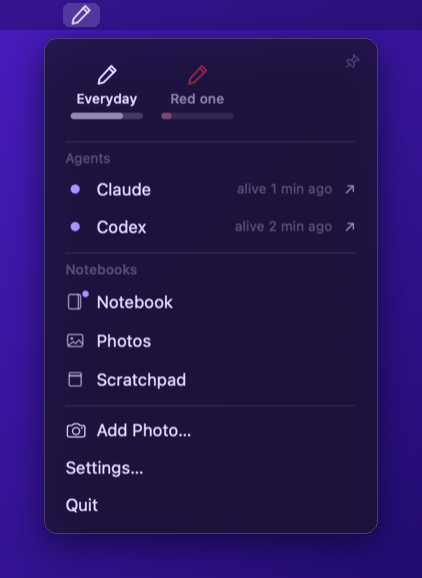

<p align="center">
  
</p>

<h1 align="center">Open Smart Pen</h1>

<p align="center">
  <strong>You write. Your agent acts.</strong><br>
  A free, open-source Mac app that gives your handwritten pages to your own AI agent.
</p>

<p align="center">
  <a href="https://opensmartpen.org/">Website</a> ·
  <a href="#get-started">Get started</a> ·
  <a href="#documentation">Documentation</a> ·
  <a href="CONTRIBUTING.md">Contributing</a>
</p>

---

Open Smart Pen is a small app in the macOS menu bar. It captures what a smartpen writes on paper and keeps each page as plain files in a folder on your Mac. Your agent, for example Claude Code or Codex, reads the pages and does the rest: it transcribes them, makes tasks, writes messages, builds what you sketched.

The app does one job. It does not transcribe, it has no account, and it never sends us what you write.

<p align="center">
  
</p>

## How it works

1. **You write** on paper with a smartpen. The pen sends each stroke to your Mac over Bluetooth. Away from the Mac, the pen keeps the pages and sends them when it is back.
2. **The app keeps each page** in `~/OpenSmartPen`: the strokes, with the time of each one, and a picture of the page. If you connect an S3 bucket, it copies the same files there.
3. **Your agent reads the pages.** One small file says when a page changed, so an agent can check often at almost no cost. The agent writes the text of each page back, and the app shows it beside the ink.

You do not need a pen to try it. The app also takes a photo of a handwritten page, from an iPhone or from a file.

## What you need

- A Mac with macOS 13 or later.
- An agent that can read files: Claude Code, Codex, or another one. An agent in the cloud works too, with the S3 bucket.
- A smartpen from the list below, or only your phone.

### Pens

| Pen | Paper | Status |
| --- | --- | --- |
| Neo smartpen A1 | Ncode paper | Tested |
| LAMY safari all black ncode | LAMY digital paper, Ncode paper | Tested |
| Moleskine smart pen | Ncode paper | Tested |
| Other Neo smartpens (M1+, N2, R1, dimo) | Ncode paper | Not tested |

The pens that are not tested use the same technology as the tested ones, and so does Moleskine paper, which is not tested yet. Pens and papers are added to this list as they are tested.

### No pen

The camera of your phone is sufficient. Take a photo of any handwritten page: from the app with an iPhone or iPad near your Mac, or as a picture file from any phone. The app files the photo as a page, and your agent reads it as it reads a page from a pen.

## Get started

### 1. Install the app

Download the newest [`OpenSmartPen-<version>.dmg`](https://github.com/opensmartpen/opensmartpen/releases/latest), open it, and drag Open Smart Pen to the Applications folder. Then open the app.

- macOS asks one time for the Bluetooth permission. Allow it; without it the pen cannot connect.
- The app is in the menu bar, as a pencil. It has no window of its own and no icon in the Dock.
- The app starts when you log in, and it updates itself. A new version installs with no window, at a moment when no pen is writing. Settings → About has the switch for this, and "Check for Updates…".

The download is signed by Apoco s.r.o. and notarised by Apple.

To build the app from the source, see [`app/README.md`](app/README.md).

### 2. Add a page

- **With a pen:** switch the pen on near your Mac. The app pairs with the first pen it sees. Then write.
- **Without a pen:** click the pencil in the menu bar, then "Add Photo…". Take a photo with your iPhone, select a file, or use the sample page.

### 3. Connect your agent

Click the pencil in the menu bar, then "Copy instructions", and paste the sentence into your agent. It looks like this:

> Read https://opensmartpen.org/llms.txt and set yourself up to transcribe my Open Smart Pen pages. The pages are in the folder ~/OpenSmartPen on my Mac.

The agent reads the setup text, writes its name beside your pages, and transcribes what is there. The app then shows the agent in the panel, and the text of each page in the viewer.

The app never starts an agent. Your agent decides when it runs.

## Where your pages go

All files are in `~/OpenSmartPen`, outside the app. You can delete the app and install it again, and no page is lost.

```
last-modified.txt             when a page last changed: the one file an agent watches
books/<copy>/book.json        the name of the notebook and its paper size
books/<copy>/raw/p<N>.jsonl   the strokes of one page, with the time of each stroke
books/<copy>/pages/p<N>.png   a picture of that page
transcripts/<copy>/p<N>.md    the text of the page, written by your agent
agents/<n>.json               each agent's name, and when it was last alive
```

- **Your pages go nowhere by themselves.** With no bucket connected, all files stay on your Mac.
- **An S3 bucket is optional.** Connect one in Settings → Sync if your agent runs on a different computer. Amazon S3 and services with the same interface work, for example Cloudflare R2 and MinIO.
- **Your agent uses its own model.** When it reads a page, it sends the picture of the page to that model, as it does with any file you give it.

[`docs/processing.md`](docs/processing.md) is the full contract between the app and an agent: what the app writes, where, and when.

## Documentation

| Document | What it is |
| --- | --- |
| [`docs/architecture.md`](docs/architecture.md) | The system, and the entry point to all other documents |
| [`docs/processing.md`](docs/processing.md) | The contract with an agent: the files, their order, how to read time |
| [`docs/agent-install.md`](docs/agent-install.md) | The text an agent sets itself up from |
| [`docs/telemetry.md`](docs/telemetry.md) | What the app reports to its makers, and how to turn it off |
| [`docs/stroke-format.md`](docs/stroke-format.md) | The format of the stroke files |
| [`docs/ubiquitous-language.md`](docs/ubiquitous-language.md) | The glossary |
| [`app/README.md`](app/README.md) | How to build, install and debug the app |

## Telemetry

Usage data is off unless you say yes. The app asks one time, at the first start, and Settings → General has the switch after that. With a yes, the app reports how it is used and what goes wrong, and never what you write. With or without a yes, a check for updates tells us the app version, a random id of the install, and whether usage data is on. [`docs/telemetry.md`](docs/telemetry.md) lists each thing that is sent.

## Contributing

Bug reports and ideas are welcome. Open an issue first, so that we can agree on the change before you write code. Read [`CONTRIBUTING.md`](CONTRIBUTING.md) for the rules and for how to build and test.

## License

Apache License 2.0; see [`LICENSE`](LICENSE). A built copy of the app also contains the pen SDK, which is GPL-3.0, so the built app as a whole is GPL-3.0; see [`NOTICE`](NOTICE).

Open Smart Pen is an independent project. It is not affiliated with the maker of any pen, paper or other product that it works with or names. All product names and trademarks are the property of their owners.
