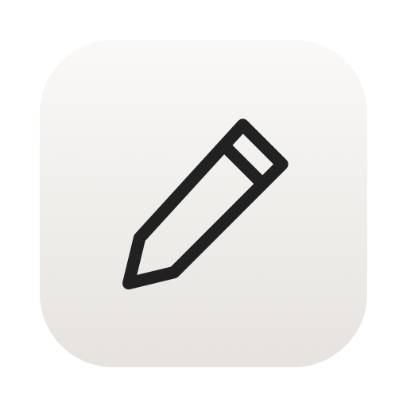

# Open Smart Pen

An open-source macOS menubar app for Neo smartpens. It captures what the pen writes on Ncode paper and keeps it as plain files in `~/OpenSmartPen`: the strokes of each page and a PNG of it. If you connect an S3 bucket, the same files are copied there.

The app does not transcribe. A reader of your choice, for example an AI agent, reads the folder or the bucket and writes the text. `docs/processing.md` is the contract with that reader.

Tested with the Neo smartpen A1 and the LAMY Safari Ncode, on NeoLAB Ncode A4 paper and LAMY digital paper. macOS 13 or later.

- `RESEARCH.md` — SDK, protocol, vendor app and field research (2026-09-10).
- `docs/architecture.md` — system overview and entry point to the docs.
- `docs/stroke-format.md` — the raw JSONL stroke format and derived files.
- `docs/decisions.md` — running decision log; formal records in `docs/adrs/`.
- `docs/landscape-log.md` — how other products solve each concern, and how we differ.
- `docs/ubiquitous-language.md` — glossary.

Components:

- `app/` — the macOS menubar app, on NeoLAB's NISDK3. See `app/README.md` to build and install it.
- `docs/processing.md` — what the app writes, where and when, for whatever reads it.
- `pipeline/` — earlier local scripts for rendering and transcribing. Not used by the app.
- `docs/adrs/` — architecture decision records.

## License

- The source code in this repository is licensed under Apache-2.0. See `LICENSE`.
- The app links NISDK3, NeoLAB's pen SDK, which is GPL-3.0. A built copy of the app is thus distributed under GPL-3.0 as a whole. See `NOTICE`.
- NISDK3 is not in this repository. The build downloads it.
- Open Smart Pen is not affiliated with NeoLAB Convergence, Inc.
- To contribute, read `CONTRIBUTING.md` first.
