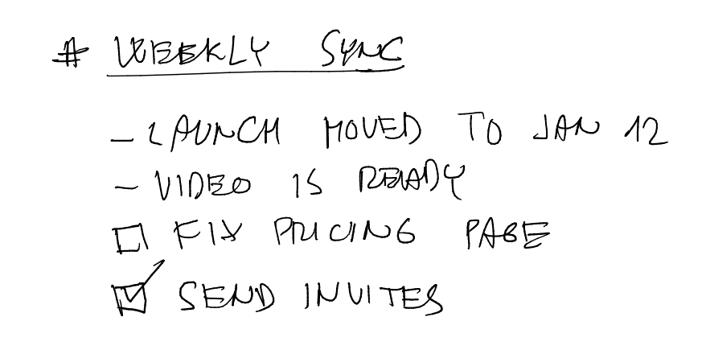

# To-dos in your notes

You take notes as always. When something must be done, you draw a small box before the line. Your agent makes a task from each box, in Apple Reminders or in your task app. When you tick or cross the box on paper later, the agent marks the task as done.

From this page the agent makes two tasks: "Fix pricing page", open, and "Send invites", done. The lines with a dash stay notes.

To use it, give your agent this sentence:

> Read `use-cases/pen-todos/SKILL.md` in https://github.com/opensmartpen/opensmartpen and use it for my Open Smart Pen pages.

The instructions for the agent are in [`SKILL.md`](SKILL.md).
